# Architecture

Mermaid diagrams for **Page Builder Kit Bundle** (rendered by GitHub, many IDEs, and Spec Kit docs viewers), plus the ports, SPI and events hosts use and the standard Symfony and DDD host paths (REQ-ARCH-001).

## Table of contents

- [System overview](#system-overview)
- [Doctrine model](#doctrine-model)
- [Document schemas](#document-schemas)
  - [Classic schema v1 (sections → columns → widgets)](#classic-schema-v1-sections--columns--widgets)
  - [GrapesJS schema v2](#grapesjs-schema-v2)
- [Admin edit → public render](#admin-edit--public-render)
- [Draft / publish lifecycle](#draft--publish-lifecycle)
- [Revisions](#revisions)
- [GrapesJS Twig pipeline](#grapesjs-twig-pipeline)
- [Security](#security)
- [Asset upload](#asset-upload)
- [Public routing & i18n](#public-routing--i18n)
- [Ports, SPI and events](#ports-spi-and-events)
- [Standard Symfony and DDD hosts](#standard-symfony-and-ddd-hosts)
  - [Standard Symfony host](#standard-symfony-host)
  - [DDD / hexagonal host](#ddd--hexagonal-host)
- [REQ-ARCH-001 status](#req-arch-001-status)
- [Deferred to 2.0](#deferred-to-20)
- [Related docs](#related-docs)

---

## System overview

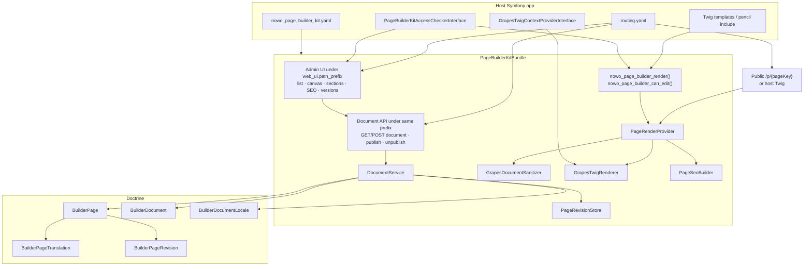

---

## Doctrine model

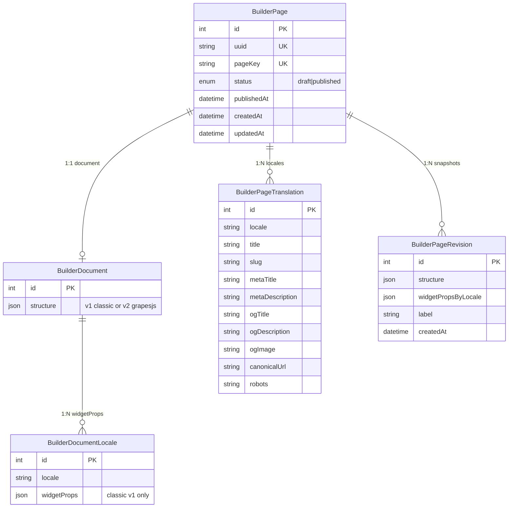

Tables default to `pb_*` (optional `doctrine.table_prefix`).

---

## Document schemas

### Classic schema v1 (sections → columns → widgets)

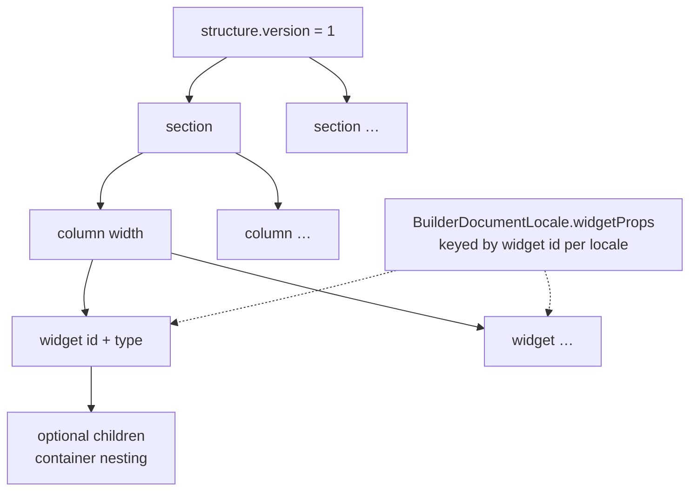

### GrapesJS schema v2

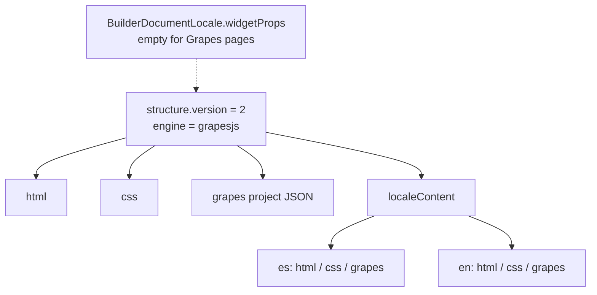

---

## Admin edit → public render

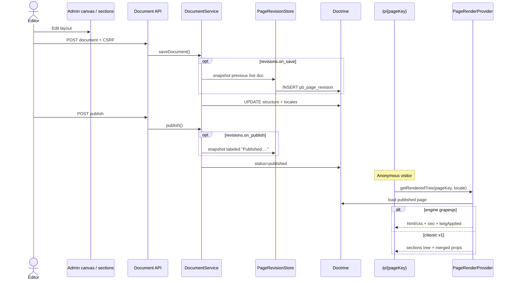

---

## Draft / publish lifecycle

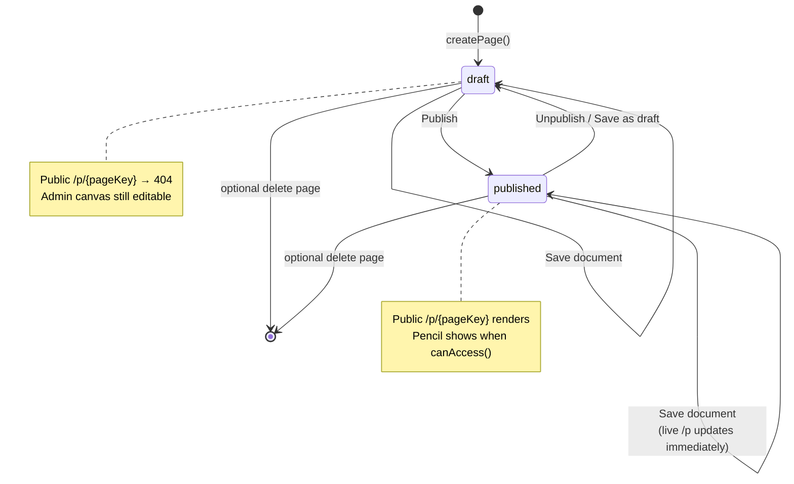

---

## Revisions

Enabled with `revisions.enabled: true`.

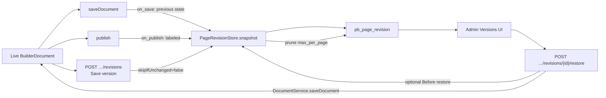

---

## GrapesJS Twig pipeline

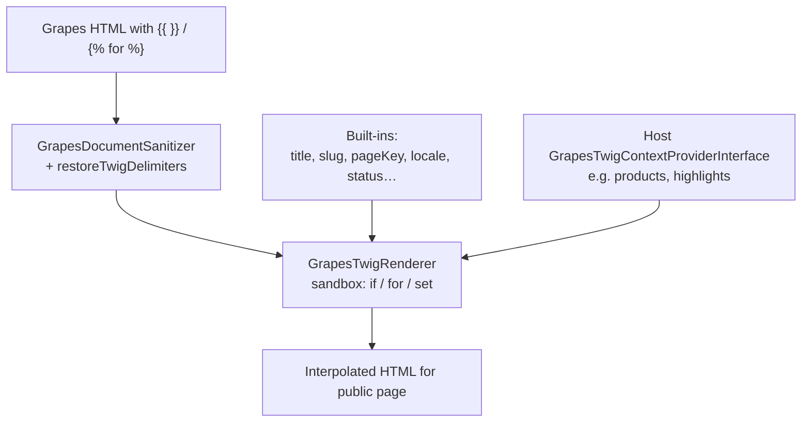

---

## Security

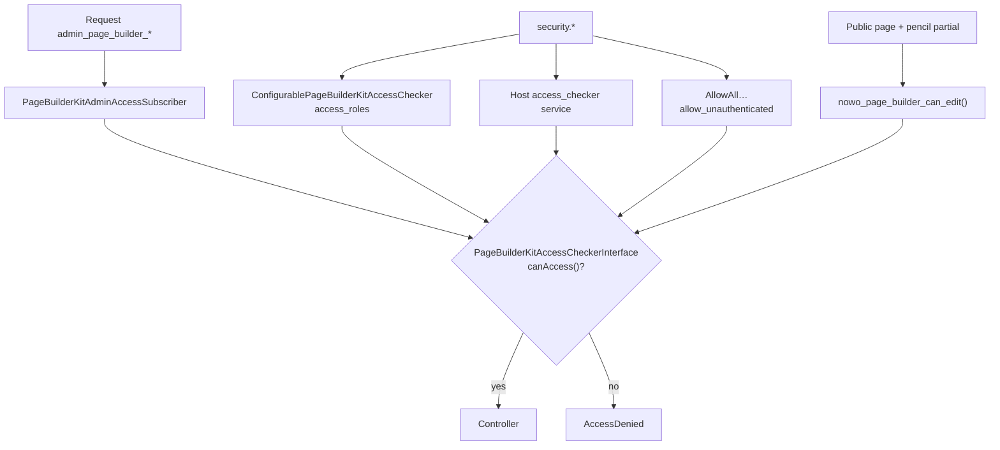

---

## Asset upload

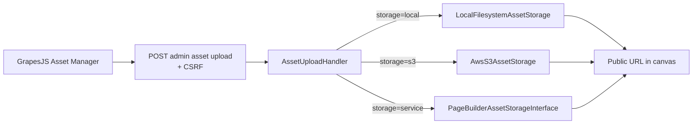

---

## Public routing & i18n

One `BuilderPage` (`pageKey`) holds all locales. **Pretty URLs are host-owned.**

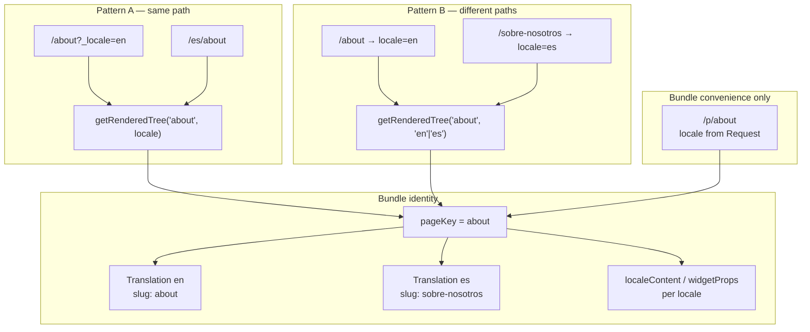

Details and code samples: [USAGE.md — Associating pages with public routes](USAGE.md#associating-pages-with-public-routes-i18n).

## Ports, SPI and events

Every port is an interface aliased in the container (autowire the interface; a host may alias it to its own service or
decorate it). No port, event or VO of this list takes a Symfony, Doctrine or HTTP type, except the deprecated ones.

| Interface | Kind | Built-in service / notes |
|-----------|------|--------------------------|
| `Service\PagePublisherInterface` | port (1.14) | `DocumentService`: create, save, publish, unpublish **by page key** |
| `Service\PageRenderProviderInterface` | port | `PageRenderProvider`: the render tree of a page |
| `Service\InlineContentFieldRendererInterface` | port | `InlineContentFieldRenderer`: one content field of a page |
| `Service\PublicBindHydratorInterface` | port | `PublicBindHydrator`: binds content fields into Grapes HTML |
| `Persistence\PageBuilderPendingEventsInterface` | port (1.14) | `PageBuilderTransaction`: dispatch the write events after your commit (`transaction: host`) |
| `Repository\BuilderPageRepositoryInterface`, `BuilderPageRevisionRepositoryInterface`, `BuilderPageTemplateRepositoryInterface`, `BuilderPageStatusQueryInterface` | read ports | bundle repositories; they return the bundle's own entities (standard hosts) or scalars |
| `Security\PageBuilderKitAccessCheckerInterface` | SPI | `security.access_checker`, else the role-based checker |
| `Media\PageBuilderAssetUploadStorageInterface` (1.15), `PageBuilderAssetLibraryInterface` | SPI | asset storage (`AssetUpload` VO); `PageBuilderAssetStorageInterface::store(UploadedFile)` is deprecated |
| `Service\GrapesTwigPageContextProviderInterface` (1.15) | SPI (tag `nowo_page_builder_kit.grapes_twig_context`) | `PageContext` VO; `GrapesTwigContextProviderInterface` (entity) is deprecated |
| `Content\ContentFieldDefinitionProviderInterface` | SPI | catalogue of content fields per page key |
| `Widget\WidgetTypeInterface`, `WidgetPackInterface`, `Grapes\GrapesBlockPackInterface` | SPI (tags) | classic widgets and GrapesJS blocks |
| `Security\Html\PageBuilderHtmlSanitizerInterface` | SPI | `html.sanitize.service` |
| `Debug\PageBuilderKitTraceInterface` | internal | profiler trace |

Events (`Event\*`: `PageCreatedEvent`, `PageDocumentSavedEvent`, `PageMetadataSavedEvent`, `PagePublishedEvent`,
`PageUnpublishedEvent`, `PageRevisionRestoredEvent`, `PageTemplateChangedEvent`) carry ids and scalars only and are
dispatched after the commit (never inside a flush, never for a rollback). Presentation stays themable through Twig
templates and the FormKit / UiKit profiles (REQ-TWIG-001); form types and page factories are UI services, not ports.

## Standard Symfony and DDD hosts

Both paths are supported; the standard one is the zero-config default. Examples: [USAGE.md](USAGE.md#standard-symfony-and-ddd--hexagonal-hosts).

### Standard Symfony host

Nothing to configure: the six bundle entities are mapped with attributes on the manager that maps them (your default
one), the admin UI and `DocumentService` flush their writes (`doctrine.transaction: bundle`), and listeners receive the
id events after the commit.

### DDD / hexagonal host

Opt-in, nothing of it is forced on standard hosts:

```yaml
nowo_page_builder_kit:
    doctrine:
        entity_manager: page_builder   # a manager that maps ONLY the bundle entities
        transaction: host              # the bundle never flushes when your code calls it
        mapping_type: xml              # 1.16: the shipped XML mapping instead of the attributes
```

- **Mapping.** The bundle entities are bundle-owned (no host entity extends or uses anything of the bundle; pages are
  addressed by key and uuid). `doctrine.mapping_type: xml` (1.16) registers `src/Resources/config/doctrine-xml/*.orm.xml`
  (same tables, columns, indexes and constraints as the attributes; checked by `tests/Unit/Doctrine/XmlMappingParityTest.php`)
  on `doctrine.entity_manager`, for managers that load XML mapping only. You may also map that directory yourself
  (`type: xml`, `prefix: Nowo\PageBuilderKitBundle\Entity`, `is_bundle: false`) on the manager you set in
  `doctrine.entity_manager`.
- **Persistence.** `entity_manager` keeps the entities on that manager only; `transaction: host` leaves the commit to
  your use case and the events wait for it (`PageBuilderPendingEventsInterface`).
- **Calls.** `PagePublisherInterface` (by key), `PageRenderProviderInterface`, the id events.

`tests/Integration/Persistence/PageBuilderPersistenceKernelTest.php` boots both shapes (attribute and XML mapping, own
manager, host transaction mode).

## REQ-ARCH-001 status

| Rule | Status | Where |
|------|--------|-------|
| 1. Interfaces + VOs | ✅ | ports above; key-based publisher (1.14), `PageContext` / `AssetUpload` VOs (1.15) |
| 2. No forced base class / trait | ✅ | bundle-owned entities, attribute mapping by default, XML mapping (1.16) |
| 3. No framework types in ports, events, VOs | ✅ | deprecated `store(UploadedFile)` / entity context provider kept until 2.0 |
| 4. Events carry ids | ✅ | `Event\*` |
| 5. SPI documented | ✅ | this page, [WIDGET_AUTHORS.md](WIDGET_AUTHORS.md) |
| 6. Never flush the host EM | ⚠️ default until 2.0 | `doctrine.transaction: bundle` without `entity_manager` flushes the manager that maps the entities (the host default one) |
| 7. Events after commit | ✅ | after-commit middleware + outbox (1.14) |
| 8. Config through provider ports | ✅ | config tree and the SPI above |

## Deferred to 2.0

Tracked in [UPGRADING.md](UPGRADING.md#to-1160):

- **Rule 6 default.** Without `doctrine.entity_manager`, `transaction: bundle` (the default) flushes the manager that
  maps the bundle entities, which in a standard host is the default one (pending host changes included). Changing the
  default to a bundle-owned manager or to `host` mode in 1.x would move the tables to another manager or stop
  persisting the writes of existing hosts, so it waits for a major. Until then: set `doctrine.entity_manager` (and,
  for DDD hosts, `transaction: host`).
- **Removal of the deprecated SPI.** `PageBuilderAssetStorageInterface::store(UploadedFile)` and
  `GrapesTwigContextProviderInterface::getContext(BuilderPage, …)`.

## Related docs

- [USAGE.md](USAGE.md) — routes, Twig, i18n URL patterns, revisions, draft/publish, standard and DDD hosts
- [CONFIGURATION.md](CONFIGURATION.md) — YAML options
- [SECURITY.md](SECURITY.md) — access and sanitization
- [SPEC-DRIVEN-DEVELOPMENT.md](SPEC-DRIVEN-DEVELOPMENT.md) — phases and REQ anchors
- [USE-CASES.md](USE-CASES.md) — demo matrix
